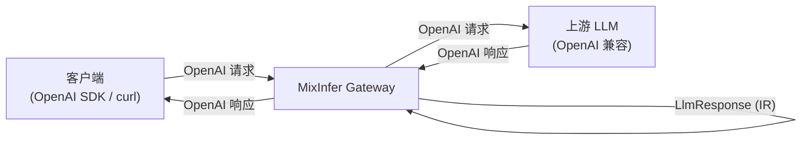

# MixInfer 架构

> 本文档描述 MixInfer 的整体架构与请求链路。
> 后续版本会在此文档上增量补充，不做破坏性修改。

## 1. 设计目标

MixInfer 的核心目标：

> **将客户端的 LLM 请求，经由 MixInfer，可靠地转发到任意 OpenAI 兼容端点，并以统一格式返回——无论是否流式。**

架构设计遵循五条原则：

1. **语义先于协议** —— 内部模型（IR）描述"语义"，协议转换器处理"格式"。
2. **配置驱动** —— Provider / Endpoint / Model 通过配置声明，不硬编码。
3. **关注点分离** —— 路由准备、健康过滤、选择、执行各自独立。
4. **可观测** —— 每个请求有 requestId，每次结算有状态。
5. **诚实降级** —— 不确定时保守处理，不用可用性换正确性。

## 2. 高层链路



## 3. 请求链路

### 3.1 非流式

```text
客户端
  ↓
RequestIdFilter（生成 requestId，写入 MDC）
  ↓
ApiKeyFilter（认证）
  ↓
ChatCompletionController
  ↓
ChatCompletionService.handle()
  ↓
RoutePlanner.plan(model)
  ├── ModelRouter.route(model)               → List<RouteTarget>
  ├── EndpointHealthTracker.filter(...)      → 过滤不健康候选
  └── EndpointSelector.order(...)            → 有序候选
  ↓
for each candidate:
  provider.invoke(llmRequest, endpoint)
  ├── 成功 → 记录成功、返回
  └── 失败 → FailureClassifier.classify()
      ├── 可 failover → 尝试下一个
      └── 不可 failover → 抛异常
  ↓
LlmResponse
  ↓
LlmToOpenAIConverter
  ↓
客户端
```

### 3.2 流式

```text
客户端
  ↓
ChatCompletionController
  ↓
ChatCompletionService.handleStream()
  ↓
Phase 1 — Open（允许 failover）
  for each candidate:
    provider.invokeStream(...)
    ├── 成功 → 获得 LlmStream，退出循环
    └── 失败 → 分类 + 记录，尝试下一个
  ↓
Phase 2 — Forward（禁止 failover）
  streamingWriter.prepare(response)   ← 响应已提交
  while (chunk = stream.next()) != null:
    streamingWriter.writeData(response, ...)
  streamingWriter.writeDone(response)
```

**关键时序**：SSE 响应头只在**上游流成功打开后**才写出。路由失败、认证失败、
上游返回 4xx/5xx 时，客户端仍能看到干净的 HTTP 错误响应。

### 3.3 客户端断开

```text
客户端断开
    ↓
ServletOutputStream.flush() 抛 IOException
    ↓
ChatCompletionService 捕获
    ↓
LlmStream.close() —— 取消上游 HTTP 连接
    ↓
UsageRecord(settlementStatus = UNKNOWN, reason = client_disconnected)
```

**没有这一步**，客户端断开后 MixInfer 会继续消耗上游 token 而无接收方。

## 4. 模块布局

```text
mixinfer-gateway/
└── src/main/java/com/mixinfer/
    ├── config/         配置绑定（MixInferProperties）
    ├── domain/         IR：LlmRequest / LlmResponse / LlmStreamChunk / UsageRecord
    ├── openai/         OpenAI 兼容 DTO
    ├── converter/      DTO ↔ IR 转换
    ├── provider/       LlmProvider / StreamingLlmProvider SPI + OpenAI 实现
    ├── streaming/      SSE 解析与响应写入
    ├── metering/       用量结算与落盘
    ├── router/         路由层
    │   ├── ModelRouter / RoutePlanner / Endpoint / RouteTarget
    │   ├── EndpointSelector / SequentialSelector
    │   ├── health/     EndpointHealthTracker / InMemoryEndpointHealthTracker
    │   └── failure/    FailureType / FailureClassifier / DefaultFailureClassifier
    ├── auth/           ApiKeyFilter / ApiKeyValidator
    ├── web/            Servlet 层横切组件（RequestIdFilter）
    ├── api/            Controller
    ├── service/        编排层
    └── exception/      统一异常
```

## 5. 核心抽象

### 5.1 LlmRequest / LlmResponse（IR）

**IR（Internal Representation）** 是 MixInfer 的核心抽象。

- 它描述**语义**，不描述**协议**。
- 每个字段的含义在所有 Provider 上一致。
- Provider 特有能力通过 `extensions` 字段透传。

详细设计见 [ADR-001](adr/001-use-semantic-ir.md)。

### 5.2 LlmStreamChunk（流式 IR）

流式响应的每个块是**增量**，不是完整响应，因此使用独立类型：

```java
public class LlmStreamChunk {
    String id;
    String model;
    int index;
    LlmMessageDelta delta;   // 增量内容
    String finishReason;     // 仅最后一块有
    LlmUsage usage;          // 仅最后一块有（如果上游返回）
}
```

`LlmStreamChunk` 是语义级 IR，不是 OpenAI chunk 的重命名。任何 Provider
都可以通过自己的 Stream Adapter 映射到它。

### 5.3 LlmProvider / StreamingLlmProvider（SPI）

两个独立接口：

```java
public interface LlmProvider {
    String name();
    LlmResponse invoke(LlmRequest request, Endpoint endpoint);
}

public interface StreamingLlmProvider {
    String name();
    LlmStream invokeStream(LlmRequest request, Endpoint endpoint);
}
```

**接口分离**：不支持流式的 Provider 不必实现流式接口。

### 5.4 LlmStream（流式 IO 抽象）

```java
public interface LlmStream extends AutoCloseable {
    LlmStreamChunk next() throws IOException;
    @Override void close();
}
```

**为什么不用 `Stream<LlmStreamChunk>`**：Java `Stream<T>` 建模有限惰性集合，
缺少资源释放、取消、IO 异常三类语义。`LlmStream` 是长生命周期、可中断的 IO 流。

### 5.5 Provider / Endpoint / RouteTarget

三层概念：

| 概念 | 含义 |
|---|---|
| **Provider** | 上游实例（配置里的 `name`），引用一个实现类型（`type`） |
| **Endpoint** | 已解析的连接信息：baseUrl、apiKey、超时 |
| **RouteTarget** | 路由条目，V0.3.0 只含 endpoint |

**实例名与类型名分离**：`name` 用于路由引用，`type` 用于查找实现。
多个实例可共享同一实现（如两个不同的 OpenAI 兼容上游）。

### 5.6 路由准备：RoutePlanner

```text
RoutePlanner.plan(model)
    = ModelRouter.route(model)
    → EndpointHealthTracker.filter(candidates)
    → EndpointSelector.order(healthy)
```

**准备步骤共享，执行步骤不共享**。流式与非流式的 failover 语义差异过大，
强行合并会让抽象充满分支。

### 5.7 FailureType

失败按**语义**分类，不按 Java 异常类型：

| FailureType | 可 failover |
|---|---|
| CONNECTION_FAILURE / CONNECT_TIMEOUT / READ_TIMEOUT | ✅ |
| HTTP_408 / HTTP_5XX / HTTP_429 | ✅ |
| AUTHENTICATION_FAILURE / INVALID_REQUEST / MODEL_NOT_FOUND | ❌ |
| UNKNOWN | ❌（保守） |

### 5.8 EndpointHealthTracker

内存级、实例级的顾问性组件。规则：

- 连续失败 N 次标记 unhealthy
- 任意成功重置
- 冷却 T 秒后恢复
- **全部 unhealthy 时仍返回全部候选**——健康状态不能导致"无端点可用"

### 5.9 UsageRecorder

结算记录接口。V0.3 只有 `FileUsageRecorder`，将 `UsageRecord`
以 JSON Lines 追加写入文件。V0.4 会加入数据库实现。

## 6. 用量结算

流式场景下 usage 不是必然可得的：

- 某些上游不返回 usage
- 客户端断开时无法知道上游实际生成了多少 token

因此结算是**显式状态机**：

| 场景 | settlementStatus | usageSource | reason |
|---|---|---|---|
| 正常结束（有 usage） | FINAL | PROVIDER | — |
| 正常结束（无 usage） | UNKNOWN | NONE | — |
| 客户端断开 | UNKNOWN | NONE | client_disconnected |
| 上游断开（有部分 usage） | PARTIAL | PROVIDER | upstream_stream_error |
| 上游断开（无 usage） | UNKNOWN | NONE | upstream_stream_error |
| 全部 Endpoint 打开失败 | UNKNOWN | NONE | all_endpoints_failed |

**核心原则**：客户端断开 ≠ 上游停止计费。诚实记录 `UNKNOWN`，比编造数字更专业。

## 7. 配置示例

```yaml
mixinfer:
  api-keys:
    - key: "sk-mixinfer-xxx"
      name: "default"
  providers:
    - name: openai-compatible
      type: openai-compatible
      base-url: https://api.deepseek.com
      api-key: ${DEEPSEEK_API_KEY}
      connect-timeout-seconds: 5
      request-timeout-seconds: 120
  routes:
    - model: deepseek-flash
      targets:
        - provider: openai-compatible
  health:
    enabled: true
    failure-threshold: 3
    cooldown-seconds: 30
  usage:
    file: logs/usage.log
```

## 8. V0.3 不做的内容

以下明确**不在 V0.3 范围内**：

- 同 Endpoint 重试（LLM 请求不具备通用幂等性；V0.3 暂不实现，未来可按失败阶段分层评估）
- 加权随机路由
- 主动健康探测（探测请求产生真实费用）
- 熔断器
- 流生命周期上限与 idle timeout
- 成本 / 配额 / 限流
- 多租户 / RBAC
- 控制平面 / Web 控制台
- 多语言 SDK
- 嵌入式模式

## 9. 后续方向

V0.4 将在现有数据平面之上叠加治理层：

- 用量持久化（SQLite）与查询
- 成本计算
- 请求限流（Rate Limit）
- 额度控制（Quota / Budget）

具体设计见 [ADR-004](adr/004-usage-cost-rate-limit-quota.md)（待撰写）。

这些会在后续版本逐步引入。见 [README 路线图](../README.md#路线图)。